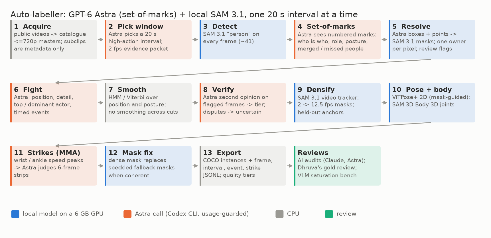

# Kakashi auto-labeller: labelling combat-sports video with a VLM agent and SAM 3.1

Research code and experiment records for building a labelled dataset of MMA and jiu-jitsu (no-gi and gi) video:
an acquisition and catalogue pipeline, and an **auto-labeller** that pairs **GPT-6 Astra** (an agentic vision-language
model, called through the Codex CLI) with **SAM 3.1** running locally on a 6 GB GPU. SAM 3.1 finds every person in
every frame. Astra sees those detections as numbered marks ("set-of-marks") and decides who is who, what role and
posture each person has, which marks merge two people and who was missed. Later stages add positions, events, strikes,
12.5 fps masks, 2D skeletons and 3D bodies.

Every quality number here says who judged it. Most come from **AI reviewers** (Claude agents, or Astra itself): they
are AI references, not human ground truth. The only human measurement is Dhruva's gold review
([E09](experiments/E09-gold-review/)), and it is lower than every AI audit.

One folder per experiment: [`experiments/`](experiments/). Findings log: [`FINDINGS.md`](FINDINGS.md). How the stages
fit together: [`docs/PIPELINE.md`](docs/PIPELINE.md). Export format: [`docs/EXPORT.md`](docs/EXPORT.md).

**No footage here.** The source videos are public uploads under third-party copyright. This repository holds no
frames, crops, masks over frames, video, source lists or label files, so every figure is a diagram or a chart. The
labels themselves are in a private dataset, available on request.

## Where it stands (October 2026)
Export `autolabel-v1` (2026-10-12): **1,526 twenty-second intervals from 670 videos**, 65,159 frames at 2 fps,
485,028 person masks (every visible person, spectators included), identity, role, posture, position and top/dominant
athlete per frame, 3,795 timed events and 1,322 strikes ([`docs/export_summary.json`](docs/export_summary.json)).
Outside the export, kept per interval: 2D skeletons and 3D bodies for every interval, and 12.5 fps masks and
skeletons for 1,160 intervals (280,235 frames).

| Label | AI reviewers (Claude agents) | Dhruva's gold review (human) |
|---|---|---|
| person masks | 85% good, 10% partial, 5% wrong (833 actor-frames) | 12/23 pairs with both masks good |
| identity across frames | 4 errors in 324 frames | 12/19 fully right; no true identity switch (the misses were bad masks) |
| position (class) | 2.8% of 324 frames wrong | 14/20 right (11/20 with detail and top athlete) |
| events | not measured | 12/18 fully right |
| strikes | 6/6 strips plausible | 13/20 fully right |

The two columns use different samples (the gold items over-sample hard cases and the rejected tier), so they are not
a like-for-like comparison. They still point the same way: AI audits were more lenient than Dhruva.

- **Hard case: interlocked bodies.** Masks are near-perfect when people are apart. In guard, mount and leg
  entanglements the bottom athlete loses limbs to the partner, and those frames are often unflagged
  ([E07](experiments/E07-scale-up-audit/), [E09](experiments/E09-gold-review/)). Replacing the worst masks with
  12.5 fps video masks was judged "only slightly better" by Dhruva ([E11](experiments/E11-mask-fix/)). The follow-up
  (tracking ownership through tangles, dot-assisted correction) lives in the
  [limb-entanglement](https://github.com/dhruvinci/limb-entanglement) repository.
- **Astra is near its ceiling on positions and events** with better prompts (at best 14/17 and 13/16 gold cases,
  against Dhruva's corrected labels); what remains needs longer context or inference beyond the pixels
  ([E10](experiments/E10-vlm-saturation-bench/)).
- **Roboflow parity is not measured.** No Roboflow predictions were run on these frames
  ([E02](experiments/E02-roboflow-comparison/)).
- **Cost:** the first 200 intervals (with calibration and retries) took 22.3 Astra call-hours and 14% of a weekly
  plan allowance ([E04](experiments/E04-autolabel-first-run/)); everything local ran on one 6 GB GPU.

## Layout
- `src/`: the code (flat modules; each states its environment and usage in its docstring). `src/config/` holds
  example configs (search queries, channel lists).
- `experiments/E<nn>-<name>/`: `README.md` (short) and `RESULTS.md` (the full record, with the workspace file and
  line behind every number).
- `docs/`: [pipeline](docs/PIPELINE.md), [export format](docs/EXPORT.md), versioned Astra prompts and the label
  taxonomy (`docs/autolabel/`), figures (`docs/assets/`).
- `tests/`: unit tests for the CPU parts (`python -m unittest discover -s tests`; 58 tests).
- `env/`: pinned package lists of the four environments.
- `tools/make_figures.py`: draws every figure from the recorded numbers.

Data directories (`media/`, `evidence/`, `autolabel/`, `manifests/`, `exports/`, `reviews/`) are created next to
`src/` when the code runs; they are git-ignored.

## Models and tools (not redistributed here)
- **GPT-6 Astra** (OpenAI), called with the logged-in Codex CLI (`codex exec`), with a usage guard that stops at 90%
  of the plan window and never redeems reset credits (`src/autolabel_astra.py`).
- **SAM 3 / 3.1** (Meta, SAM License; `sam3.1_multiplex.pt`) and **SAM 3D Body** (Meta). The resolve stage also needs a
  tracker-only SAM 3.1 adapter from a separate, unpublished project (see `src/autolabel_fuse.py`).
- **ViTPose+** (`usyd-community/vitpose-plus-base`), **faster-whisper** (local speech recognition), **yt-dlp** and
  **ffmpeg**.
- Paths to checkpoints and model code: environment variables `KAKASHI_SAM31_CKPT`, `KAKASHI_SAM3D_BODY`,
  `KAKASHI_SAM31_ADAPTER` (defaults follow the author's layout under `~/Code`).

## Related
- [engage3d](https://github.com/dhruvinci/engage3d): measuring two-person engagement in 3D; reuses the 2D-pose and
  3D-body stages from here.
- [limb-entanglement](https://github.com/dhruvinci/limb-entanglement): the tangle tracker and dot-assisted mask
  correction that followed [E11](experiments/E11-mask-fix/).

## Licence
Code: MIT ([`LICENSE`](LICENSE)). Documents, results and figures: CC BY 4.0. Third-party models, tools and footage
keep their own licences; the footage is not redistributed.

## Citation
See [`CITATION.cff`](CITATION.cff).
