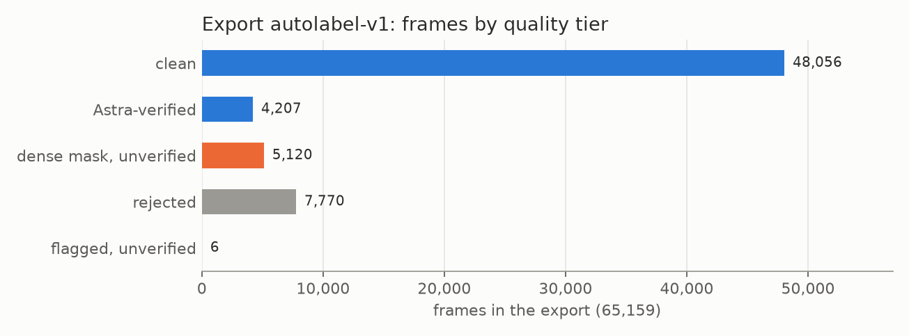

# Export format: `autolabel-v1`

Written by `src/autolabel_export.py` (2026-10-12). The export itself is **not** in this repository: it refers to
frames of third-party videos. The labels are in a private dataset, available on request. This page documents the format and the
aggregate counts ([`export_summary.json`](export_summary.json), made by `src/export_summary.py`).

All labels are machine-made (SAM 3.1, GPT-6 Astra, ViTPose+, SAM 3D Body). Quality figures come from AI reviewers
except Dhruva's gold review ([E09](../experiments/E09-gold-review/)). Every source is development data; no held-out
test split exists yet.

## Files
| file | one row per | fields |
|---|---|---|
| `instances.coco.json` | person instance (COCO instance segmentation, category `person`) | box, compressed RLE mask, area; `attributes`: `actor_id`, `track_id` (interval-scoped), `role`, `posture`, mask `source`, `primary`, `largest_component_share`, `maskfix`, uncalibrated `mask_signals`; image fields: `time_s`, `is_keyframe`, `review_flags`, `risk_flags`, `info_flags`, `quality_tier` |
| `frames.jsonl` | frame (2 fps) | `shot_type`, `pair_configuration`, `clip_context`, `quality_tier`, smoothed `position`, `position_detail`, `engagement`, `top_actor`, `dominant_actor`, `review_flags` |
| `intervals.jsonl` | 20 s interval | time range on the source, `clip_context`, actors (id, role, short appearance description, `primary`) |
| `events.jsonl` | timed event | type, actor, target, start/end, outcome, detail, `crosses_shot_cut`, `actor_inferred` |
| `strikes.jsonl` | strike (MMA) | time, striker, target actor, type, target, result, the joint whose speed peak proposed it |
| `manifest.json` | export | counts, taxonomy hash, SHA-256 of every input `labels.json`, flag policy |

Every visible person is an instance, spectators included (role `spectator_or_crew`), so no person is silent
background. Pixels are exclusive: each pixel belongs to at most one person.

## Counts
Source: [`export_summary.json`](export_summary.json).

| | |
|---|---|
| intervals / sources | 1,526 / 670 |
| frames (2 fps) | 65,159 (7,980 with review flags) |
| person instances | 485,028 |
| events | 3,795 (striking exchange 1,201, takedown 556, pass 415, stand-up 407, reset 326, ...) |
| strikes | 1,322 |
| frame positions | guard 21,591, standing 20,253, transition 3,796, side control 3,723, transition or uncertain 3,123, not applicable 2,794, turtle 2,737, back 2,536, mount 2,334, leg entanglement 2,128, unknown 144 |

## Quality tiers (per frame)
| tier | rule | frames |
|---|---|---|
| `clean` | no review or risk flags | 48,056 |
| `astra_verified` | flagged; Astra's second opinion says both primary masks are correct | 4,207 |
| `dense_replaced_unverified` | a primary mask was replaced by the 12.5 fps video mask after verification ([E11](../experiments/E11-mask-fix/)) | 5,120 |
| `rejected` | Astra confirms a mask problem | 7,770 |
| `flagged_unverified` | flagged, no second opinion | 6 |

A frame whose position Astra disputed gets position `transition_or_uncertain`; leave it out of position training.

Recommended subsets ([E04](../experiments/E04-autolabel-first-run/)): drop intervals with more than 40% flagged
frames or `identity_unstable`; for detection, roles and classification also drop frames with `review_flags`; for
instance-segmentation training on grappling also drop `risk_flags`. How well the tiers predict human judgement:
rejected 2/8 mask pairs good vs 10/15 for clean and verified ([E09](../experiments/E09-gold-review/)); small sample.

## Known issues
- The primary pair is chosen once per interval: in 4.0% of position-labelled frames the pair's primary athlete is not
  in the frame ([E09](../experiments/E09-gold-review/)).
- Tangled ground positions: masks of the bottom athlete lose limbs to the partner, often without a flag
  ([E07](../experiments/E07-scale-up-audit/)).
- `mask_signals` are uncalibrated; skeleton-based signals reached about 30% precision.
- 60 events cross a camera cut (`crosses_shot_cut`).
- The manifest's `split` text says "trial100 calibration sources"; it predates the scale-up. Every source in the
  export is development data.
- `intervals.jsonl` holds short appearance descriptions of real people (clothing, hair, skin); review them before any
  release.
- Dense masks, skeletons and 3D bodies are kept per interval and are not part of this export.
