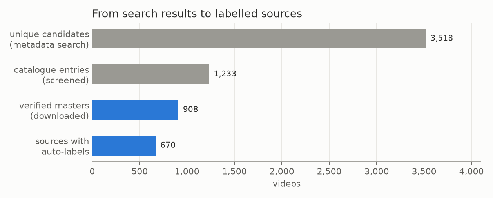

# E00 — Acquisition and catalogue

**Objective.** Collect about 1,000 varied MMA and no-gi videos (gi added later) as compressed local masters, with
every subclip stored as metadata only, inside fixed storage limits.

**Setup.**
- Metadata search with yt-dlp (`src/discover.py`), then a conservative title and channel screen
  (`src/select_sources.py`, `src/gi_select.py`); sport and context are hypotheses until someone looks.
- SQLite catalogue with a byte-space guard (`src/catalog.py`): media cache at most 70 GB, at least 30 GB free, pause
  at either limit, never delete or re-encode to make room. About 20 GB more was approved for gi.
- One resumable download worker (`src/acquire.py`): at most 720p, audio kept, ffprobe checks, hashes, bounded
  retries, publisher chapters kept as intervals.

**Results** (catalogue state on 2026-10-26)
| | MMA | no-gi | gi | all |
|---|---|---|---|---|
| catalogue entries | 524 | 476 | 233 | **1,233** |
| verified masters | 365 | 400 | 143 | **908** (145.7 h, 82.6 GB) |

**Verdict.** **Done for v1.** Downloads paused at the cap; 670 of the 908 videos now have auto-labels.
**Learned.** Titles mislead: sampled frames moved sources between training and tutorial, found a gi montage inside
a no-gi video and a static music mix. Publisher chapter times are rounded and can run past the video's end.
**Next.** Group sources (re-uploads, same match, same session) before any test split. None is frozen yet.

Files: `RESULTS.md`.
