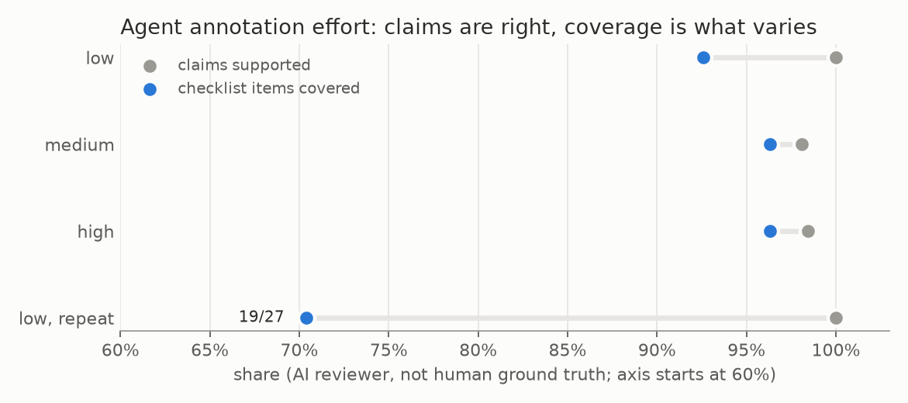

# E01 — Agent annotation: one-video pilot and 100-source trial

**Objective.** Before any segmentation model: can GPT-6 Astra session agents annotate combat video richly (grounded
claims, identities, sparse boxes and landmarks) and at which reasoning effort?

**Setup.**
- Pilot: one 9 min 24 s competition video, 2 fps previews and local speech recognition. Low, medium and high effort
  annotate the same eight 12 s excerpts. A fresh AI reviewer agent writes an evidence checklist
  before seeing the anonymised outputs, then scores them.
- Trial: 100 sources x two 20 s intervals (4,000 s) at the chosen setting; 27 sources AI-audited.

**Results** (AI reviewer, not human ground truth)
| | low | medium | high |
|---|---|---|---|
| claims supported | 90/90 | 102/104 | 125/127 |
| checklist items covered | 50/54 | 52/54 | 52/54 |
| low effort, repeat on 4 excerpts | 47/47 claims, **19/27** checklist | | |
- Trial: 3,213 claims and 1,286 sparse geometry records; audited 906/909 claims and 319/355 boxes supported.
- Geometry on only 647 of 7,926 sampled core frames.

**Verdict.** **Pass for rich text, fail as a vision dataset.** Production used medium effort and 30 s packets.
**Learned.** Correct claims alone are a weak measure: low effort was always right but missed what mattered. Sparse
boxes on selected actors cannot train a detector.
**Next.** Compare with Roboflow's Auto Label ([E02](../E02-roboflow-comparison/)).

Files: `RESULTS.md`.
