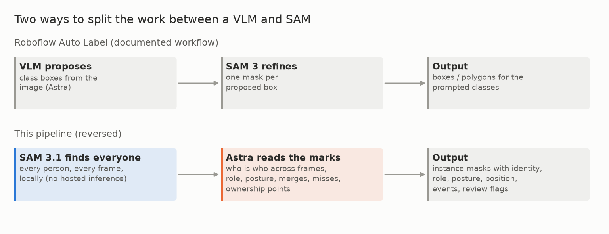

# E02 — Comparison with Roboflow's Auto Label

**Objective.** Is the agent annotation of [E01](../E01-agent-annotation-trial/) as good as, or better than,
Roboflow's documented Auto Label workflow (GPT-6 Astra + SAM 3)?

**Setup.**
- Read-only review of the frozen trial delivery (3,213 claims, 1,286 geometry records).
- A fresh AI spot check of 12 original stills from six previously unaudited sources (one per sport and context),
  plus a second AI check of five stills.
- Roboflow's documentation and published benchmark read. **No Roboflow predictions were run on these frames**
  (no hosted inference, near-zero credit use).

**Results**
| | finding |
|---|---|
| combat meaning | richer: claims in four evidence kinds (visual, temporal, spoken, uncertain) |
| vocabulary | free text: 1,872 distinct claim kinds, 572 keypoint names |
| geometry | 647 of 7,926 core frames; 1,121 boxes on selected actors only |
| errors found by eye | a visible head outside its box; a hip point on the back; visible people with no box |
| Roboflow's published Astra detection | 82.1 / 83.6 mAP@50 (low / high effort) on its own benchmark: not comparable |

**Verdict.** **Not measured.** Neither parity nor superiority can be claimed; richer text is not better geometry.
**Learned.** Detection, classification and instance segmentation need every visible person on every frame. That set
the design of the auto-labeller: SAM 3.1 finds everyone locally, and Astra decides who is who.
**Next.** The reversed pipeline ([E03](../E03-autolabel-calibration/)). A fair comparison still needs the same images,
the same label rules and human references for both workflows.

Files: `RESULTS.md`.
