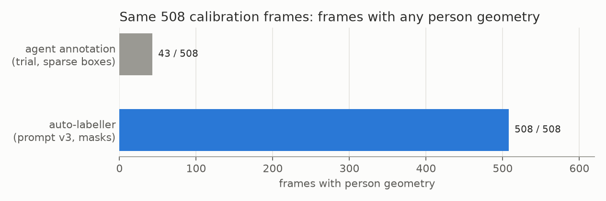

# E03 — Auto-labeller calibration: set-of-marks prompts v1-v3

**Objective.** Does Astra reading numbered SAM 3.1 detections give complete, identity-consistent person masks, and
what does the prompt need?

**Setup.**
- 12 intervals (one source per sport and context cell, two intervals each), 508 frames at 2 fps; development data.
- SAM 3.1 detects "person" on every frame. Astra gets six keyframes in full and the rest as 2x2 tile sheets, and
  returns strict JSON. Its boxes and points are turned into masks by SAM 3.1.
- Compared with the sparse boxes of [E01](../E01-agent-annotation-trial/) on the same frames.

**Results** (prompt v3; model agreement plus a visual check by the AI agent running it)
| | |
|---|---|
| frames labelled | 508/508 (agent annotation: 43) |
| person instances | 2,600 (1,595 athletes, referees, instructors, coaches) |
| earlier person boxes matched at IoU >= 0.5 | 77/79 (median best IoU 0.88) |
| frames flagged for review | 118/508 (23%), mostly entangled no-gi |
| cost per interval | 33-36k input, 4-15k output tokens; 190-610 s per call |

**Verdict.** **Pass (exploratory).** Prompt v4 (role definitions) went to the full run.
**Learned.** Each prompt version fixed one failure: v2 labels every frame, v3 adds two ownership points per person.
The released SAM 3.1 checkpoint has no trained box-to-mask head, so boxes go through the tracker decoder.
**Next.** All 200 trial intervals ([E04](../E04-autolabel-first-run/)).

Files: `RESULTS.md`. Prompts: [`docs/autolabel/`](../../docs/autolabel/).
