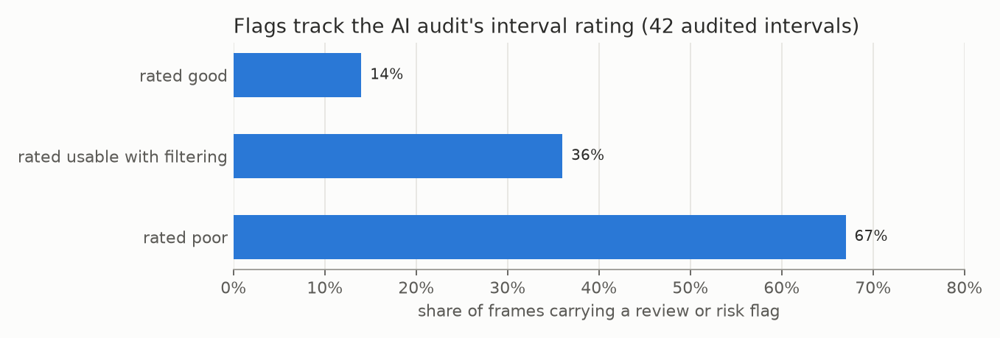

# E04 — First full run: 200 trial intervals, AI-audited

**Objective.** Label all 200 intervals of the 100-source trial and find out which labels are usable for training.

**Setup.**
- 8,512 frames at 2 fps; detect, set-of-marks (prompt v4) and resolve for every interval.
- Corpus metrics (`src/autolabel_review.py`) and a visual audit by four Claude reviewer agents: 42 intervals (30 at
  random, 5 per sport/context cell; 9 worst-scoring; 3 extra), 460 frames, 1,192 actor-frames.
- No human ground truth: every figure is model agreement or AI visual judgement.

**Results** (AI audit)
| task | quality | usable for training? |
|---|---|---|
| person detection | 98.3% of earlier person boxes matched; people missing in 0.3% of actor-frames | yes |
| masks, people apart | near-perfect | yes |
| masks, ground grappling | 90% good, 8% partial, 1.8% wrong | after filtering |
| identity across frames | no swaps in 38 of 42 intervals | yes, minus 2 unstable intervals |
| position | 1.5% of frames clearly wrong | with caution |
| posture | 5.8% of frames wrong | weak label |
- 49,794 person instances; cost 22.3 Astra call-hours, 14% of the weekly plan window (with calibration and retries).

**Verdict.** **Usable with filtering** (AI audit only).
**Learned.** Flags rank quality (14% / 36% / 67% of frames flagged in good / usable / poor intervals) but miss
errors: 61 errors had no flag, mostly posture, position and masks that swallow the partner.
**Next.** A second opinion on flagged frames ([E05](../E05-second-opinion-verify/)).

Files: `RESULTS.md`.
