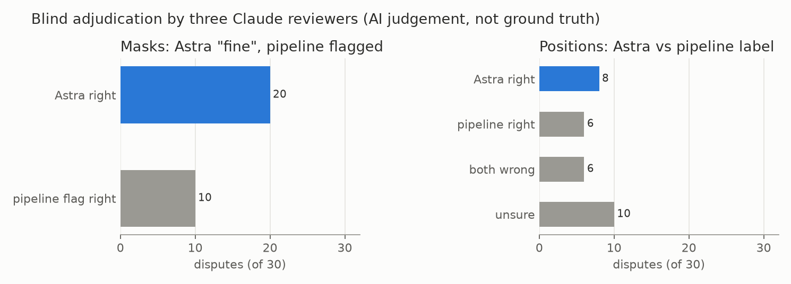

# E05 — Second opinion on flagged frames, with blind adjudication

**Objective.** Can a second Astra pass separate real mask and position errors from false alarms in flagged frames?

**Setup.**
- All 2,018 trial frames with review or risk flags. The primary pair is filled red and blue on zoomed crops, eight
  frames per Astra call; Astra judges each mask and the printed position (`src/autolabel_verify.py`).
- 60 disagreements judged by three Claude agents, shown as A/B claims with the source hidden.

**Results** (Astra's second opinion; Claude adjudication; both AI)
| Astra on 2,018 flagged frames | |
|---|---|
| both masks correct | 553 frames (27%) |
| missing parts / includes the other person | 1,458 / 977 actor-judgements |
| wrong person / merged | 121 / 65 actor-judgements |
| position disputed | 250 frames (12%) |
- Adjudication: on masks Astra was right in 20/30 disputes; on positions 8 Astra, 6 pipeline, 6 both wrong, 10 unsure.

**Verdict.** **Adopted.** Each frame gets a quality tier (clean / Astra-verified / rejected); a disputed position
becomes `transition_or_uncertain` and is left out of position training.
**Learned.** Most disputed mask flags were false alarms (occlusion, people leaving the frame, look-alike outfits).
Position disputes are mostly genuinely ambiguous; all three reviewers asked for a scramble/transition class.
**Next.** Scale up to every downloaded source ([E07](../E07-scale-up-audit/)).

Files: `RESULTS.md`.
