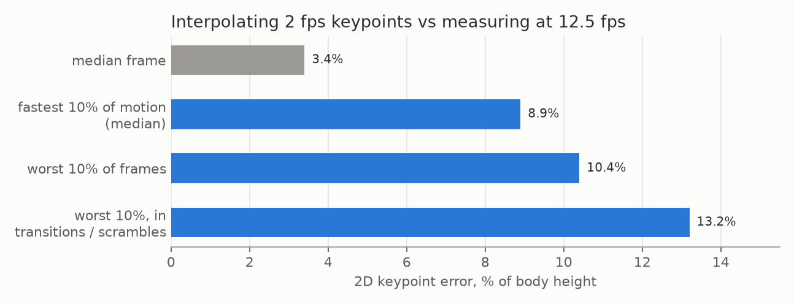

# E06 — Densify to 12.5 fps, 2D pose, 3D body; does 12.5 fps add information?

**Objective.** Turn 2 fps labels into 12.5 fps masks and skeletons on a 6 GB GPU, and measure whether the extra
frames carry new information.

**Setup.**
- Densify (`src/autolabel_densify.py`): the official SAM 3.1 multiplex video predictor, fitted to 6 GB (detector
  matrices in bf16, three upstream fixes), prompted at clean Astra-labelled frames; every third one is held out.
- 2D pose: ViTPose+ per person with the partner's pixels greyed out. 3D body: SAM 3D Body prompted with each person's
  own box and mask, every second label frame.
- Frame-rate test (`src/fps_value.py`): 720 densified intervals, about 206k joint measurements, camera cuts and
  identity jumps excluded.

**Results**
| | |
|---|---|
| held-out frames, all 1,160 densified intervals | median IoU **0.953**; 10th percentile 0.712; 70% >= 0.9 |
| interpolated vs measured keypoints | median 3.4% of body height; worst 10%: 10.4%; worst 10% in scrambles: 13.2% |
| mask halfway between 2 fps frames vs nearest 2 fps mask | median IoU 0.61; 64% below 0.7 |
| fast wrist peaks that fall on a 2 fps frame | 57% of 851 |

**Verdict.** **Adopted** where motion is fast: 12.5 fps for one window per source and the full matches. The
held-out IoU compares two model outputs, so it is self-consistency, not accuracy.
**Learned.** Most motion is slow enough for 2 fps; scrambles and strikes are not, and masks change a lot within
0.25 s. In tangles the under-masked person's skeleton inherits the mask error, because it is prompted by that mask.
**Next.** Strikes from the 12.5 fps skeletons ([E08](../E08-strike-pass/)).

Files: `RESULTS.md`, `heldout_summary.json` (from `src/densify_heldout_summary.py`).
