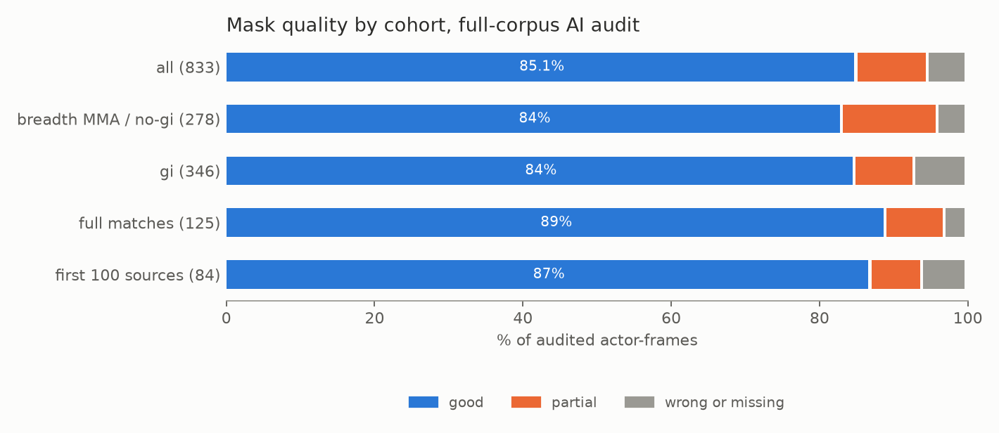

# E07 — Scale-up to 1,526 intervals and a full-corpus AI audit

**Objective.** Run the whole pipeline on every cohort (breadth, gi, full matches) and re-audit quality.

**Setup.**
- 1,526 intervals from 670 videos: 942 breadth MMA / no-gi, 200 trial, 198 gi, and 186 chunks from 15 sources
  labelled as whole matches or rounds.
- An orchestrator keeps one GPU job and up to six Astra jobs running, resumes from files, and is restarted by a
  watchdog.
- Audit: 36 intervals across all cohorts, four Claude agents, 9 frames each: 324 frames, 833 actor-frames.

**Results** (AI audit, not human ground truth)
| | |
|---|---|
| intervals | 21 good, 13 usable with filtering, 2 poor |
| masks (actor-frames) | 85.1% good, 9.6% partial, 5.3% wrong or missing |
| identity / position / top-dominant actor | 4 errors / 9 of 324 frames (2.8%) / 11 errors |
| real errors with no flag | 58 frames |
| full matches keeping one identity across chunks | 7 of 11 |

**Verdict.** **Usable with filtering**; the flags miss most tangle errors.
**Learned.** The failure is interlocked bodies: the bottom or behind athlete loses legs or head to nothing or to the
partner. Smoothing had broken position/detail pairs (fixed, all re-smoothed). The primary pair is chosen once per
interval and mixes pairs in 25% of intervals. Skeleton-based mask checks were no better than the flags.
**Next.** The first human measurement ([E09](../E09-gold-review/)).

Files: `RESULTS.md`.
