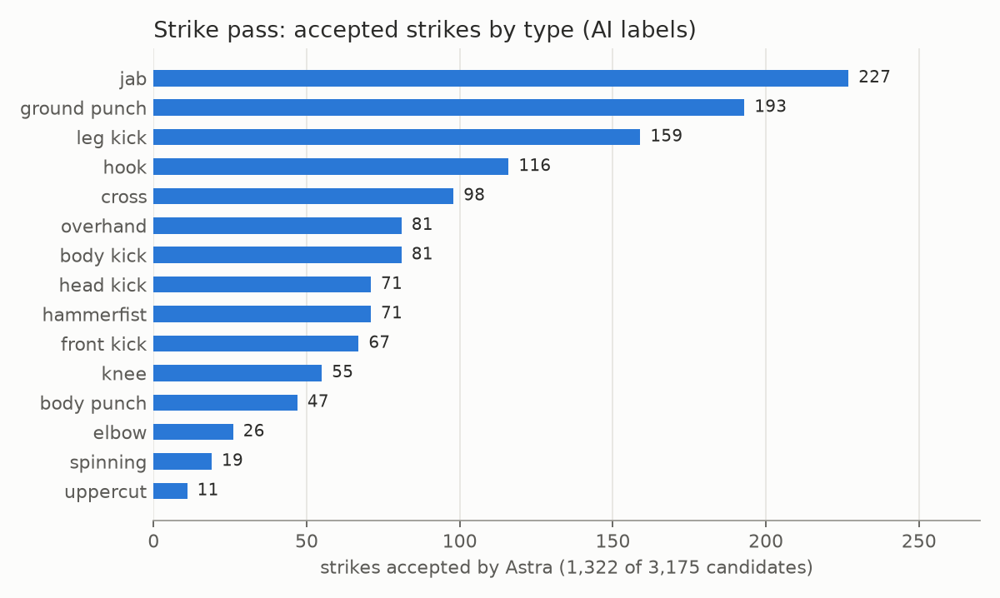

# E08 — Strike pass for MMA intervals

**Objective.** Label individual strikes (who, which type, target, result), which 2 fps frames miss
([E06](../E06-densify-and-frame-rate/)).

**Setup.**
- All 269 densified MMA intervals that contain striking (`src/autolabel_strikes.py`).
- Candidates: speed peaks of wrists, elbows, knees and ankles in the 12.5 fps skeletons above 3 body heights per
  second; camera cuts and identity jumps excluded; peaks within 0.4 s merged.
- Astra judges each candidate on a strip of six frames 80 ms apart with the pair outlined.

**Results**
| | |
|---|---|
| candidates | 3,175 |
| strike / not a strike / unclear (Astra) | 1,322 / 1,770 / 83 |
| result of the 1,322 (Astra) | blocked 389, unclear 368, landed partly 203, landed clean 203, missed 159 |
| spot check (Claude, 6 strips) | all plausible |
| Dhruva's gold review | 13/20 fully right; rejected candidates 5/6 right |
| cost | weekly plan window 76% -> 84% for about 890 calls |

**Verdict.** **Usable as AI labels for standing striking; weak on the ground and in the clinch.**
**Learned.** Errors come from context (a face push read as a ground punch, an up-kick as a head kick) and from strips
holding a combination. Recall is bounded by the skeleton: a strike from an occluded limb is never proposed.
**Next.** Measure missed strikes outside the candidates; audio (impacts, the referee) as a second signal.

Files: `RESULTS.md`.
