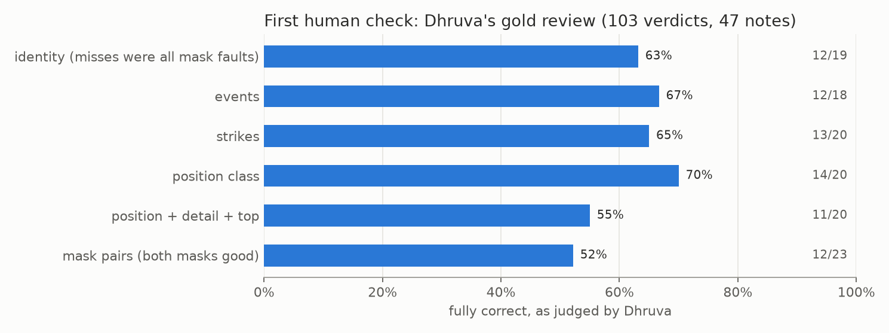

# E09 — Gold review by Dhruva: the first human measurement

**Objective.** Measure label accuracy with a human, after several rounds of AI-only audits.

**Setup.**
- A gold pack of 854 stratified items, fixed seed (`src/gold_build.py`): 300 masks (by quality tier), 296 positions
  (37 per class), 100 identity checks, 98 events (7 per type), 60 strikes (45 accepted, 15 rejected).
- A local review page (`src/gold_serve.py`, `src/gold_review.html`): items cropped to the main pair, types interleaved
  in blocks of 10. Dhruva's written notes override the keypresses.
- First session: 103 verdicts and 47 notes in about 70 minutes.

**Results** (Dhruva; `unclear` excluded)
| | fully correct | what went wrong |
|---|---|---|
| identity | 12/19 | no true switch; the misses were bad masks of the right person |
| events | 12/18 | outcomes over-claimed (a finished choke called a reset) |
| strikes | 13/20 | ground and clinch context |
| position | 11/20 (class 14/20) | standing grappling labelled `transition` |
| mask pairs | 12/23 | lost legs, merges in chokes, legs swapped in leg entanglements |

**Verdict.** **AI audits were lenient.** Every type that had an AI audit number scores below it (different samples,
about 20 items each, so wide uncertainty). The rejected tier works: 2/8 mask pairs good vs 10/15 for clean and verified.
**Learned.** A follow-up analysis found that masks from Astra boxes (used when SAM merged or missed a person) were
87% bad, and that agreement with the 12.5 fps video mask best predicts a good mask. 4.0% of position frames describe a
pair whose primary athlete is not in the frame.
**Next.** How good can a VLM get on these cases ([E10](../E10-vlm-saturation-bench/)); replace the bad masks
([E11](../E11-mask-fix/)).

Files: `RESULTS.md`.
