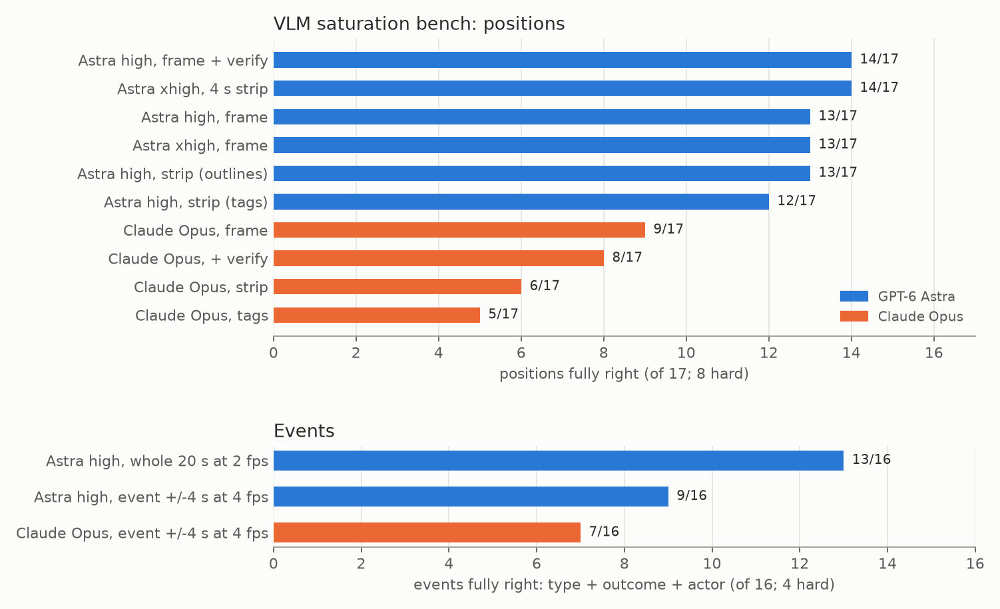

# E10 — VLM saturation bench: positions and events

**Objective.** On the cases Dhruva corrected, how good can a VLM get, and which input helps: one frame, a 4 s strip, a
verify pass, more reasoning effort, longer context?

**Setup.**
- Positions: 17 gold cases (8 hard), ground truth from Dhruva's notes (`src/vlm_bench.py`).
- Events: 16 gold cases (4 hard, where the original label was wrong) (`src/vlm_bench_events.py`). Inputs: the whole
  20 s interval at 2 fps (as in production, with a new observe-first prompt) or the event +-4 s at 4 fps.
- Astra at high and extra-high effort; Claude Opus as fresh agents that could not see the notes. All blind.

**Results**
| | positions (of 17) | hard (of 8) | events (of 16) | hard (of 4) |
|---|---|---|---|---|
| Astra, best setting | 14 | 5 | 13 (whole interval) | 2 |
| Astra, single frame / +-4 s window | 13 | 5 | 9 | 1 |
| Claude Opus, best setting | 9 | 4 | 7 | 1 |
| production labels (gold review, other cases) | 11/20 | | 12/18 | |

**Verdict.** **Astra saturates** at 13-14/17 positions and 13/16 events with better prompts. The same three position
cases fail under every setting; Dhruva's own notes call them borderline.
**Learned.** For events, longer context beats denser frames. Claude Opus trails on fine grappling detail, and
temporal strips hurt it. Caveat: some prompt rules were written after reading Dhruva's notes, so hard-case gains are
optimistic.
**Next.** A held-out check on fresh gold items; audio (taps, the buzzer, the referee) as an independent signal.

Files: `RESULTS.md`.
