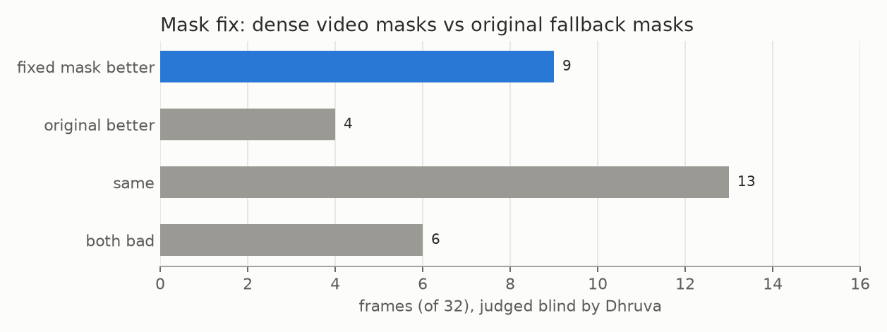

# E11 — Mask fix: replace fallback masks with 12.5 fps video masks

**Objective.** Replace the speckled masks made from Astra boxes (87% bad in [E09](../E09-gold-review/)) with the
SAM 3.1 video mask at the same moment, where that mask is coherent.

**Setup.**
- `src/mask_fix.py`: replace a primary person's fallback mask with the dense mask unless it swallows the partner
  (covers more than 35% of the partner's mask), is fragmented or fails area checks; otherwise only clean the speckle.
  Every interval is backed up; the revert was tested byte-identical.
- First densified the 204 worst intervals that had no video masks yet.
- Judged by Dhruva, blind: 40 random changed frames (32 replaced, 8 only cleaned), A/B order random.

**Results**
| | |
|---|---|
| primary fallback masks replaced | 6,565 of 11,464 (57%); the rest speckle-cleaned |
| export tiers | rejected 12,192 -> 7,770 frames; new tier "dense mask, unverified" 5,120 |
| Claude eye check, 16 replaced frames | 9 better, 5 same, 2 worse |
| Dhruva, 32 replaced frames | fix better 9 (mostly "slightly"), original better 4, same 13, both bad 6 |
| Dhruva, 8 cleaned-only frames | same 7, both bad 1 |

**Verdict.** **Fail on Dhruva's bar:** "only slightly better but not good enough yet". Shipped in the export as a
separate, unverified tier.
**Learned.** Video masks inherit the ownership errors they start from inside a tangle. Speckle cleanup is invisible
to a reviewer. The AI eye check (9/16 better) was more lenient than Dhruva (9/32).
**Next.** Track ownership through tangles from frames where the athletes are apart, with dot-assisted correction:
the [limb-entanglement](https://github.com/dhruvinci/limb-entanglement) repository.

Files: `RESULTS.md`.
